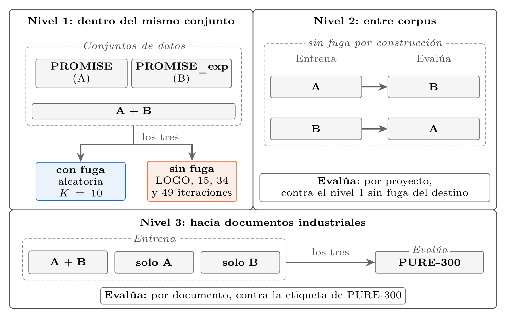

# Evaluación de clasificadores de requisitos en tres niveles

Código y datos para reproducir los resultados del artículo:

> B. Hernández Rojas, V. Rodríguez López y C. A. Fernández y Fernández. *Una evaluación comparativa del desempeño de clasificadores de requisitos funcionales*. JIISIC 2026, Lecture Notes in Computer Science, Springer.

El estudio evalúa cuatro clasificadores de requisitos funcionales (F) y no funcionales (NFR) en tres niveles que alejan progresivamente el conjunto de prueba del de entrenamiento:

1. **Nivel 1**: dentro del mismo corpus, con fuga (validación cruzada aleatoria) y sin fuga (dejando fuera un proyecto completo en cada iteración).
2. **Nivel 2**: entre corpus (PROMISE y PROMISE_exp).
3. **Nivel 3**: hacia documentos industriales (PURE-300).



*Protocolo de evaluación. Cada nivel aleja el conjunto de prueba del de entrenamiento.*

Los clasificadores son Bayes ingenuo y SVM lineal sobre TF-IDF, regresión logística sobre vectores fastText, y BERT con la configuración de NoRBERT.

## Comprobación rápida

Las predicciones de todos los modelos están incluidas. Para regenerar las Tablas 1, 2 y 3 del artículo sin entrenar nada:

```
cd code
python tablas.py
```

El script imprime las tres tablas y compara cada celda con el valor publicado. Solo usa la biblioteca estándar de Python, así que no necesita el entorno de conda. Si todo está bien, termina así:

```
Tabla 3
                       Bayes ingenuo     SVM lineal       fastText           BERT
PROMISE + PROMISE_exp           0.48           0.48           0.42    0.53 ± 0.02
PROMISE                         0.36           0.40           0.42    0.57 ± 0.06
PROMISE_exp                     0.44           0.45           0.50    0.49 ± 0.02

Las 65 celdas coinciden con el artículo.
```

## Estructura

```
code/
  fase0_prepare_corpora.ipynb    corpus armonizado (datasets/harmonized/corpus_all.csv)
  fase4_muestra_anotacion.py     muestra PURE-300 y plantillas de anotación
  fase4_acuerdo.ipynb            acuerdo entre anotadores y estándar PURE-300
  nivel1/                        nivel 1: clásicos (notebook) y BERT (script)
  nivel2/                        nivel 2: unión A+B y cruces
  nivel3/                        nivel 3: transferencia hacia PURE-300
  tablas.py                      Tablas 1, 2 y 3 del artículo
  environment.yml                entorno de conda con las versiones usadas
docs/
  protocolo.png                  figura del protocolo de evaluación
datasets/
  norbert-replication/.../promise_nfr.csv   PROMISE (fuente original)
  promise_exp.csv                           PROMISE_exp (fuente original)
  pure-xml/XMLZIPFile/                      seis documentos de PURE (fuente original)
  harmonized/corpus_all.csv                 los tres corpus limpios y armonizados
  anotacion/                                muestra, anotaciones, adjudicación y estándar PURE-300
  nivel1/, nivel2/, nivel3/                 predicciones y métricas de cada nivel
```

## Entorno

```
conda env create -f code/environment.yml
conda activate crossreq
```

Los experimentos se ejecutaron en macOS con Apple M4 Pro y 24 GB de memoria; BERT se ajustó sobre el acelerador MPS y, si no está disponible, los scripts usan la CPU. Los vectores `fasttext-wiki-news-subwords-300` (cerca de 1 GB) se descargan automáticamente con gensim la primera vez, y `bert-base-cased` se descarga desde Hugging Face.

Los notebooks se pueden abrir con `jupyter lab` o ejecutar completos desde la terminal, dentro de su carpeta:

```
cd code/nivel1
jupyter nbconvert --to notebook --execute --inplace nivel1_clasicos.ipynb
```

## Configuración de los modelos

Los cuatro modelos usan la misma configuración en los tres niveles. Los hiperparámetros que no se mencionan conservan los valores por omisión de cada biblioteca.

| Modelo | Configuración |
|---|---|
| Bayes ingenuo | TF-IDF con uno y dos gramas, frecuencia mínima de documento 2 y ponderación sublineal; `MultinomialNB` con α = 1 |
| SVM lineal | El mismo TF-IDF; `LinearSVC` con C = 1, pérdida *squared hinge* y regularización L2 |
| fastText | Promedio de los vectores `fasttext-wiki-news-subwords-300` de las palabras del requisito, estandarizado; regresión logística con L2, C = 1 y hasta 2000 iteraciones |
| BERT | `bert-base-cased` con la configuración de NoRBERT: 16 épocas, tasa de aprendizaje 2e-5, lote 16, longitud máxima 128, AdamW con calentamiento lineal del 10 % |

Particiones: en el modo con fuga, `StratifiedKFold` con 10 particiones, barajado y semilla 42, la misma para los cuatro modelos; en el modo sin fuga, `LeaveOneGroupOut` por proyecto. BERT se entrena con las semillas 13, 42, 77, 101 y 2026, y se reportan su media y su desviación estándar.

## Orden de ejecución

Cada paso lee lo que produjo el anterior. Todos los scripts y notebooks se ejecutan desde su propia carpeta.

| Paso | Archivo | Produce |
|---|---|---|
| 1 | `code/fase0_prepare_corpora.ipynb` | `corpus_all.csv`; verifica su SHA-256 |
| 2 | `code/fase4_muestra_anotacion.py` | muestra PURE-300 y plantillas de los anotadores |
| 3 | `code/fase4_acuerdo.ipynb` | kappa de Cohen, tabla de adjudicación y `gold_pure300.csv` |
| 4 | `code/nivel1/nivel1_bert.py`, `nivel1_clasicos.ipynb` | predicciones y métricas del nivel 1 |
| 5 | `code/nivel2/nivel2_bert.py`, `nivel2.ipynb` | predicciones y métricas del nivel 2 |
| 6 | `code/nivel3/nivel3_bert.py`, `nivel3.ipynb` | predicciones y métricas del nivel 3 |
| 7 | `code/tablas.py` | Tablas 1, 2 y 3 |

Los pasos 2 y 3 no hace falta repetirlos: dependen de las respuestas de los anotadores y de la adjudicación, que se incluyen. Correrlos regenera los mismos archivos.

Los notebooks de los clásicos reutilizan las predicciones guardadas si existen; para recalcularlas basta con borrar los archivos `*_predicciones_clasicos.csv`. Los modelos clásicos son deterministas: al recalcularlos desde cero se obtienen las mismas predicciones que las incluidas, byte por byte. En la máquina descrita, cada notebook de clásicos tarda menos de dos minutos (entre 102 y 106 segundos), sin contar la primera descarga de los vectores de fastText.

BERT suma 665 entrenamientos y tarda varias horas; sus scripts se pueden interrumpir y reanudar. Por eso se incluyen sus predicciones. Al reentrenarlo en otro equipo o con otro acelerador, las predicciones pueden no coincidir exactamente, aunque la media y la desviación entre semillas deberían quedar cerca de las reportadas.

Las métricas de los notebooks de nivel se calculan sobre todas las predicciones de cada condición. Las Tablas 2 y 3 del artículo reportan, en cambio, la media del F1 macro por proyecto y por documento; ambas las calcula `tablas.py`.

## De dónde sale cada cifra del artículo

| Cifras | Archivo |
|---|---|
| PROMISE con 625 requisitos (255 F y 370 NFR, 15 proyectos); 621 duplicados entre PROMISE y PROMISE_exp; 348 requisitos nuevos de PROMISE_exp (191 F y 157 NFR, 34 proyectos); 958 requisitos de PURE en 6 documentos | `code/fase0_prepare_corpora.ipynb` |
| Muestra de 300 requisitos de PURE, por documento | `code/fase4_muestra_anotacion.py` |
| Kappa de Cohen de 0.590 (decisión de requisito) y 0.385 (clase); 205 acuerdos y 95 desacuerdos; 198 requisitos por acuerdo, 67 por adjudicación y 28 descartados; 265 requisitos confirmados (166 F y 99 NFR) | `code/fase4_acuerdo.ipynb` |
| Tablas 1, 2 y 3 | `code/tablas.py` |
| 665 entrenamientos de BERT: 150 con fuga, 490 sin fuga, 10 en los cruces y 15 en el nivel 3 | `code/nivel*/nivel*_bert.py` y la columna `semilla` de sus predicciones |

## Datos

### Fuentes externas

| Corpus | Fuente | Licencia |
|---|---|---|
| PROMISE | Cleland-Huang et al. (2007). Se usa `promise_nfr.csv` del paquete de NoRBERT, Hey et al. (2020), [doi:10.5281/zenodo.3833661](https://doi.org/10.5281/zenodo.3833661). El conjunto original está en [doi:10.5281/zenodo.268542](https://doi.org/10.5281/zenodo.268542) | Paquete de NoRBERT: GPL-3.0. Conjunto original: CC BY 4.0 |
| PROMISE_exp | Lima et al. (2019), *Software Engineering Repositories: Expanding the PROMISE Database*, SBES. Archivo tomado de [github.com/AleksandarMitrevski/se-requirements-classification](https://github.com/AleksandarMitrevski/se-requirements-classification) | Sin licencia declarada en la fuente |
| PURE | Ferrari, Spagnolo y Gnesi (2017), [doi:10.5281/zenodo.1414117](https://doi.org/10.5281/zenodo.1414117). Se incluyen los seis documentos que traen requisitos marcados | CC BY 4.0 |

Estos archivos se redistribuyen sin modificaciones, con fines de reproducibilidad, y conservan la licencia y la autoría de su fuente. Si alguno de los autores prefiere que su archivo no se redistribuya aquí, se retirará y se dejará solo el enlace.

### Datos de este trabajo

- `harmonized/corpus_all.csv`: 1931 requisitos. PROMISE (625: 255 F y 370 NFR, 15 proyectos), los 348 requisitos de PROMISE_exp que no están en PROMISE (191 F y 157 NFR, 34 proyectos) y 958 requisitos de PURE sin etiqueta.
- `anotacion/`: la muestra PURE-300, las respuestas de los dos anotadores, la adjudicación de los 95 desacuerdos con su justificación, el manual que recibieron los anotadores y el estándar `gold_pure300.csv` (300 textos, 265 confirmados como requisitos: 166 F y 99 NFR).
- `nivel1/`, `nivel2/`, `nivel3/`: las predicciones de cada modelo (con su iteración, proyecto o documento y semilla) y las métricas.

### Columnas de los archivos

| Archivo | Columnas |
|---|---|
| `harmonized/corpus_all.csv` | `corpus` (PROMISE, PROMISE_exp_new o PURE), `group` (proyecto o documento), `req_id`, `text`, `label_binary` (F o NFR; vacío en PURE), `label_original` (subclase de PROMISE) |
| `anotacion/muestra_300_master.csv` | `item`, `req_id`, `documento`, `texto` |
| `anotacion/entregas/anotador_{1,2}.csv` | `item`, `texto`, `es_requisito (si/no)`, `etiqueta (F o NFR)`, `duda (si/no)`, `comentario (opcional)` |
| `anotacion/adjudicacion.csv` | las respuestas de los dos anotadores (`a1_*`, `a2_*`), `etiqueta_final`, `es_requisito_final` y `justificacion` de los 95 desacuerdos |
| `anotacion/gold_pure300.csv` | `item`, `req_id`, `documento`, `texto`, `etiqueta`, `es_requisito`, `origen` (acuerdo o adjudicación) |
| `nivel1/`, `nivel2/`: `*_predicciones_clasicos.csv` | `req_id`, `modelo`, `etiqueta`, `prediccion`, `iteracion`, `proyecto` |
| `nivel1/`, `nivel2/`: `*_predicciones_bert.csv` | `req_id`, `etiqueta`, `prediccion`, `iteracion`, `proyecto`, `semilla` |
| `nivel3/`: `*_predicciones_clasicos.csv` | `req_id`, `documento`, `modelo`, `prediccion`, `etiqueta_gold`, `es_requisito` |
| `nivel3/`: `*_predicciones_bert.csv` | las mismas, más `semilla` |
| `nivel*/nivel*_metricas.csv` | una fila por modelo y condición, con las métricas de la matriz de confusión (exactitud, precisión, sensibilidad, F1 por clase, F1 macro, MCC) y, en BERT, la desviación entre semillas |

En `iteracion`, el modo con fuga indica la partición (de 0 a 9) y el modo sin fuga el número de iteración, cuyo proyecto evaluado aparece en `proyecto`; los cruces usan 0. Las predicciones del nivel 3 no tienen esa columna, porque se entrena una sola vez. Los `req_id` empiezan con `A-` en PROMISE, `B-` en PROMISE_exp y `D-` en PURE.

## Licencia

El código se distribuye bajo la licencia MIT y los datos de este trabajo bajo CC BY 4.0; ver `LICENSE`. Los datos de fuentes externas conservan su licencia original.
